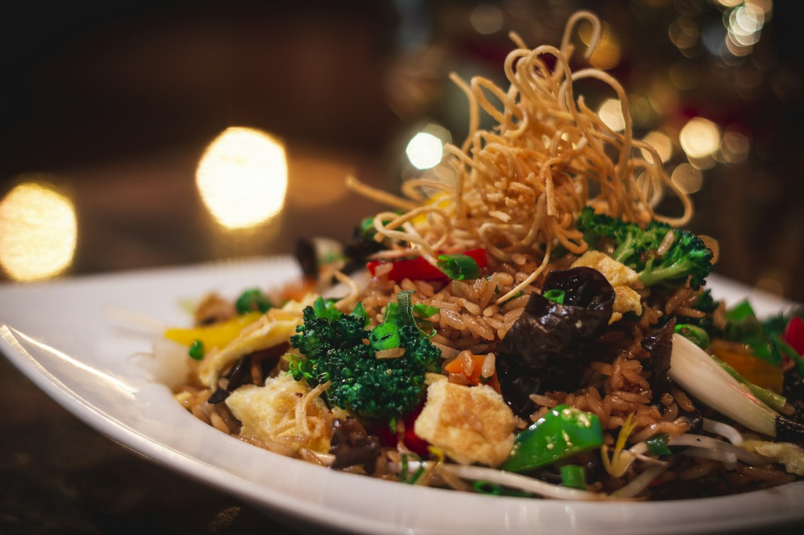

# MR RED CHEF — Multicuisine & Biryani Restaurant Website

A premium, single-page restaurant website built with **plain HTML5, CSS3 and vanilla
JavaScript**. No frameworks, no CSS libraries, no build step.

> Demo / template website prepared by **DigiMaraa**.

---

## 1. Tech stack

| Layer    | Choice                                                  |
| -------- | ------------------------------------------------------- |
| Markup   | HTML5, semantic elements, ARIA attributes                |
| Styles   | CSS3 — custom properties, grid, clamp(), no framework   |
| Behaviour| Vanilla JavaScript (ES5-safe syntax, no dependencies)    |
| Fonts    | Google Fonts — Playfair Display + Inter (self-hosted option) |
| Images   | Local files in `assets/images/` (Unsplash, free licence)|

---

## 2. Project structure

```
/
├── index.html            # Single page — all sections
├── assets/
│   ├── images/           # All photography (local, no hotlinking)
│   └── logo/             # logo.svg + favicon.svg
├── css/
│   └── style.css         # All styles, organised in 20 labelled blocks
├── js/
│   └── script.js         # All behaviour in one IIFE module
└── README.md
```

> All icons are an **inline SVG sprite** inside `index.html`, so there is no icon
> folder and no icon-font request.

---

## 3. Quick start

No build tooling required. Either:

1. Double-click `index.html`, or
2. Serve the folder locally (recommended, keeps relative paths tidy):

```bash
# any static server works — examples:
python -m http.server 8000
npx serve .
```

Then open `http://localhost:8000`.

---

## 4. Sections included

1. **Header** — transparent over the hero, solid + sticky after scroll, hamburger drawer, active-link state
2. **Hero** — two-column editorial layout, headline, dual CTA, layered food image with floating trust cards
3. **Credibility strip** — 4.4/5 rating, 2,245+ reviews, multicuisine, signature dishes
4. **About** — story, points, interior image
5. **Menu** — 8 dish cards with category filter and per-dish WhatsApp ordering
6. **Benefits** — 4 numbered icon features
7. **Why Choose Us** — large image + 4 feature cards
8. **Testimonials** — swipeable carousel, autoplay, dots, keyboard support
9. **FAQ** — accessible accordion
10. **Final CTA** + **Footer** — contact details, emails, credits

---

## 5. Changing the contact details

Everything is driven from one config block at the top of `js/script.js`:

```js
var CONFIG = {
  brandName:       'MR RED CHEF',
  contactName:     'DigiMaraa Cafe',   // used as the generic contact identity
  whatsappNumber:  '917200251560',     // digits only — change here and everywhere
  phoneDisplay:    '+91 72002 51560',
  phoneTel:        '+917200251560',
  email:           'info@digimaraa.com'
};
```

`openWhatsApp()` builds every link:

```js
openWhatsApp("Hi DigiMaraa Cafe, I would like to place an order.");
```

Reusable API exposed on `window`:

```js
MRC.config                                   // read the live config
MRC.openWhatsApp('My message here')          // opens WhatsApp in a new tab
MRC.whatsappUrl('My message here')           // returns the URL only
```

Per-button message copy lives in the `MESSAGES` map in the same file. Dish buttons
use `data-dish="Chicken Biryani"` and generate
`"Hi DigiMaraa Cafe, I'm interested in Chicken Biryani. Please share the details."`

---

## 6. Replacing the hero image

The hero photo is a clearly marked placeholder. Find it in `index.html`:

```html
<!-- HERO IMAGE: Replace this image manually -->

```

Steps:

1. Drop the client's photo into `assets/images/`.
2. Update the `src`.
3. Update `alt` with a real description of the dish.
4. Keep a **3:2 landscape** ratio (e.g. 1200 × 800) so the frame never crops oddly —
   the stylesheet uses `object-fit: cover` inside a fixed-ratio frame.
5. Update the same file at around line 400 for the Open Graph / social share image.

Other placeholders to swap before launch: the interior shot, grill shot, CTA
background, and the dish photos. All live in `assets/images/` with descriptive
filenames, and every one carries alt text.

---

## 7. Images

All photography is stored locally — nothing hotlinks to a stock CDN at runtime.
Source photos are from **Unsplash** under the Unsplash Licence (free for commercial
use, attribution not required).

| File                        | Used for                | Size    |
| --------------------------- | ----------------------- | ------- |
| `hero-food.jpg`             | Hero (replaceable)      | 137 KB  |
| `biryani.jpg`               | Chicken Biryani card    | 74 KB   |
| `food-1.jpg`                | Chicken 65 Biryani card | 172 KB  |
| `food-2.jpg`                | Mutton Biryani card     | 99 KB   |
| `grilled-chicken.jpg`       | Chicken Grill card      | 60 KB   |
| `mandi.jpg`                 | Mandi card              | 81 KB   |
| `tandoori-chicken.jpg`      | Tandoori Chicken card   | 141 KB  |
| `fried-rice.jpg`            | Fried Rice card         | 96 KB   |
| `naan-gravy.jpg`            | Naan & Gravy card       | 117 KB  |
| `restaurant-interior.jpg`   | About section           | 163 KB  |
| `why-us-grill.jpg`          | Why Choose Us           | 119 KB  |
| `cta-bg.jpg`                | Final CTA background    | 164 KB  |
| `social-og.jpg`             | Open Graph share image  | 141 KB  |

Total ≈ 1.5 MB for the whole site. All below-the-fold images use
`loading="lazy"` + `decoding="async"`; the hero uses `fetchpriority="high"`.
No image is larger than 172 KB. To go further, re-encode to WebP/AVIF and swap
the extensions — no code changes needed.

---

## 8. Accessibility

- Semantic landmarks: `header`, `nav`, `main`, `section`, `footer`
- One `h1`, then `h2` / `h3` in order — no skipped levels
- Skip-to-content link
- Alt text on every image; `aria-hidden` on all decorative glyphs
- `aria-label` on every icon-only button; visible `:focus-visible` ring
- FAQ accordion uses `aria-expanded`, `aria-controls` and labelled regions
- Mobile drawer traps Tab focus, closes on `Esc`, locks page scroll
- Carousel supports arrow keys, `aria-roledescription`, and labelled dot buttons
  (`aria-current` marks the active slide)
- **Touch targets ≥ 24 × 24 CSS px** (WCAG 2.5.8 AA). Carousel dots keep their
  9 px visual pill but sit in a 24 × 24 px transparent button via `::before`, so
  enlarging the hit area never changes the design
- Colour contrast: white on `#000`, `#FF0000` accents on dark at 5.2:1, and a
  red gradient (`#FF0000 → #C40000`) behind white button text so solid CTAs
  stay AA-compliant
- Inline SVG sprite avoids a 200 KB icon library

---

## 9. Motion

- `IntersectionObserver` fade-up reveal with per-item delays
- Hero image float loop, floating trust cards, spice-dot drift
- Card lift, button lift, underline sweep on the headline
- Animated counters, carousel, accordion, drawer
- **Full `prefers-reduced-motion` support** — floats, bobbing, parallax and
  reveals are disabled; reveal content renders instantly

---

## 10. Responsive breakpoints

| Range    | Layout                                                        |
| -------- | ------------------------------------------------------------- |
| ≥ 1181px | 4-column menu, 4-up benefits, hero 2-column, sticky header    |
| 1025–1180| 3-column menu, hero float cards simplified                   |
| 901–1024 | 2-up stats, hero tightens                                     |
| 821–900  | Hero stacks, menu 2-up, footer 2-up                           |
| 641–820  | Hamburger menu, sticky mobile order bar, single-column heroes |
| 481–640  | Menu and benefits single column                               |
| ≤ 480px  | Single column throughout, refined type scale                  |
| ≤ 380px  | Compact float cards and nav controls for 360 px devices        |

Fluid type and spacing use `clamp()`, `minmax()` and `vmin`. Verified with no
horizontal overflow at 1440, 1280, 1024, 768, 480, 390 and 360 px.
`overflow-x: hidden` on `body` is a belt-and-braces guard only.

---

## 11. SEO

- Unique `<title>` and `meta description`
- Full Open Graph + Twitter card metadata
- Canonical URL, keywords, `theme-color`, `robots`
- Semantic heading hierarchy
- Restaurant JSON-LD (`schema.org/Restaurant`) with cuisine types, address,
  phone, email and the supplied aggregate rating
- Descriptive filenames and alt text

> Update `<link rel="canonical">` and the `og:image` path to the real domain
> when the site goes live.

---

## 12. Contact details used

```
#1, First Floor, Ambalam Street, Srivaikundam,
Tuticorin-628 601, Tamilnadu, India.

Phone   : +91 72002 51560
Official: info@digimaraa.com
Business: maraa.care@gmail.com
Career  : akash@digimaraa.com
```

Prepared as a demo/template for DigiMaraa. No original restaurant address,
phone number, awards or certifications are referenced anywhere on the site.

---

## 13. Browser support

Modern evergreen browsers — Chrome, Edge, Firefox, Safari 14+, and their mobile
counterparts. Uses `IntersectionObserver`, CSS grid, `clamp()` and CSS custom
properties; degrades gracefully (content visible, carousel/accordion static)
if JavaScript is unavailable.

---

## 14. Verification performed

Driven through headless Chrome (Puppeteer) against the real page at
**1440, 1280, 1024, 768, 480, 390 and 360 px**, both with and without
`prefers-reduced-motion: reduce`:

| Check | Result |
| ----- | ------ |
| Horizontal overflow | `scrollWidth === clientWidth`, **0** offending elements |
| Counters | Render `4.4` and `2,245` |
| Scroll spy | Correct active link for all 6 nav sections at every width |
| Sticky header | Activates after scroll at every width |
| Anchor offset | Section lands exactly `header + 16 px` below viewport top |
| Reveal animations | 40 / 40 elements revealed after full traversal |
| Order bar | Class toggles correctly; `display: none` on desktop, bar on mobile |
| Touch targets | No interactive element under 24 px tall |
| Console / network | **0 errors, 0 failed requests** |
| `node --check js/script.js` | Passes |

---

© 2026 MR RED CHEF. All Rights Reserved.
Website developed by [DigiMaraa Technologies](https://digimaraa.com).